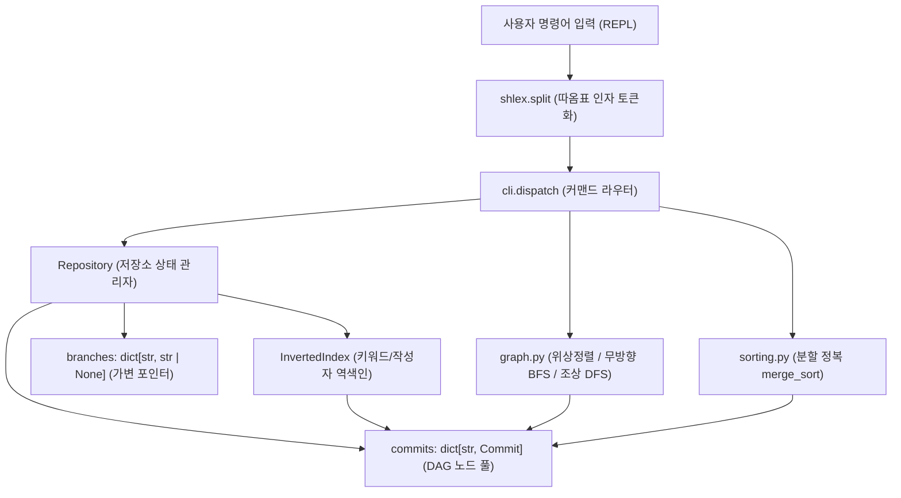
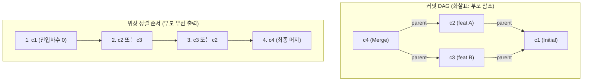
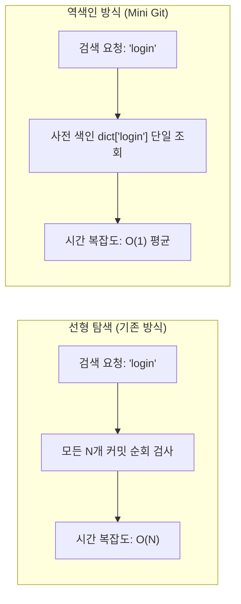

# Mini Git (b5-2) 🚀

> **AI/SW 기초 자료구조와 알고리즘 미션**: 밑바닥부터 직접 구현하는 CLI 기반 Mini Git 커밋 그래프 엔진  
> **공식 미션 명세서**: [`docs/b5_2_mission.md`](docs/b5_2_mission.md) \| **평가표**: [`docs/b5_2_eval.md`](docs/b5_2_eval.md) \| **사전 평가 보완 계획서**: [`docs/b5_2_pre_eval_plan.md`](docs/b5_2_pre_eval_plan.md) \| **기술 백과사전**: [`study/study.md`](study/study.md) \| **종합 가이드**: [`study/README.md`](study/README.md)

---

## 📖 1. 프로젝트 개요 및 코어 철학

**Mini Git**은 Git의 핵심 버전 관리 아키텍처와 커밋 그래프 구조를 깊이 있게 체득하기 위해 순수 Python 표준 라이브러리(`hashlib`, `datetime`, `shlex`)만으로 밑바닥부터 직접 개발된 경량 CLI 커밋 그래프 엔진입니다.

외부 서드파티 그래프 패키지(NetworkX 등) 및 내장 정렬 API(`sorted()`, `list.sort()`)를 일체 사용하지 않고, 직접 설계·구현한 **방향성 비순환 그래프(DAG)**, **Kahn 알고리즘 기반 위상 정렬(Topological Sort)**, **무방향 너비 우선 탐색(BFS) 최단 경로 및 사전순 타이브레이크**, **역색인(Inverted Index) 검색 엔진**, 그리고 **분할 정복 안정 병합 정렬(Merge Sort)**을 유기적으로 결합하여 완성되었습니다.



---

## 🏛️ 2. 내부 저장소 아키텍처 및 책임 분리 모델

Mini Git은 Git의 핵심 설계 철학인 **불변 객체 저장소(Immutable Object Store)**와 **가변 참조 포인터(Mutable Reference Pointers)**의 역할을 명확히 분리하여 구현되었습니다.

### 2.1 저장소 3대 구성요소 책임 매트릭스

[`src/repo.py: Repository`](src/repo.py#L25-L169) 클래스는 다음 세 가지 핵심 상태를 독립적으로 관리합니다:

| 구성요소 | 타입 | 책임 및 역할 설명 |
| :--- | :--- | :--- |
| **`commits`** | `dict[str, Commit]` | **불변 커밋 객체 풀**: 고유 해시(`str`)를 키로 하여 커밋 메타데이터(메시지, 작성자, 타임스탬프, 부모 해시 리스트)를 영구 보관하는 DAG 정점 저장소입니다. 한 번 생성된 커밋은 내용이 절대 변경되지 않습니다. |
| **`branches`** | `dict[str, str \| None]` | **가변 브랜치 참조 맵**: 브랜치 이름(`str`)을 해당 라인의 최신 커밋 해시(`str` 또는 초기 `None`)로 가리키는 포인터 맵입니다. 신규 커밋 발생 시 해당 브랜치의 포인터만 갱신됩니다. |
| **`current_branch`** | `str` | **활성 브랜치 포인터 (HEAD)**: 작업자가 현재 체크아웃하여 작업 중인 브랜치명을 가리킵니다. 기본 브랜치는 `"main"`이며, `SWITCH` 명령에 의해 가리키는 대상이 전환됩니다. |

### 2.2 커밋 불변성 및 고유 해시 생성 메커니즘

각 커밋 노드는 [`src/commit.py: Commit`](src/commit.py#L11-L61) 엔티티로 표현되며, 고유 식별자는 SHA-1 해시의 앞 6자리 16진수 문자열로 발급됩니다.

1. **결정론적 해시 생성**:
   - `_next_order`(단조 증가 6자리 시퀀스), `salt`(충돌 방지 정수), `message`, `timestamp`를 결합하여 SHA-1 해시를 계산합니다.
   ```python
   raw = f"{self._next_order}:{salt}:{message}:{timestamp}".encode("utf-8")
   digest = hashlib.sha1(raw).hexdigest()[:6]
   ```
2. **해시 충돌 방지 및 안전장치**:
   - 만약 생성된 6자리 해시가 이미 `commits` 저장소에 존재하는 경우, `salt`를 1씩 증가시키며 유일한 해시가 도출될 때까지 재시도합니다.
   - 무한 루프 가능성을 원천 차단하기 위해 최대 시도 횟수 임계값(`MAX_COLLISION_RETRIES = 1000`)을 적용하여 안전성을 확보합니다.
3. **테스트 재현성을 위한 결정론적 시드 모드**:
   - 단위 테스트 및 자동화 검증 시 동일 입력에 대해 항상 100% 동일한 해시를 재현할 수 있도록 salt/seed 초기화 옵션을 제공합니다.

### 2.3 브랜치 관리 및 저장소 초기화 예외 정책

- **`INIT <user_name>` 재실행 정책**:
  - 이미 저장소가 초기화된 상태에서 `INIT`을 다시 호출하면 기존 커밋 히스토리, 브랜치 목록, 역색인이 모두 깨끗하게 초기화되고 새로운 사용자 컨텍스트로 리셋됩니다.
- **`BRANCH <name>` 중복 생성 에러**:
  - 이미 존재하는 브랜치명을 다시 생성하려고 시도할 경우, 기존 히스토리 보호를 위해 조용히 덮어쓰지 않고 `RepoError: Branch '<name>' already exists` 예외를 발생시킵니다.
- **`SWITCH <name>` 브랜치 전환 검증**:
  - 존재하지 않는 브랜치로 전환을 시도할 경우 `RepoError: Branch '<name>' does not exist` 예외를 발생시켜 일관된 에러 처리를 보장합니다.

---

## 🕸️ 3. 그래프 알고리즘 설계 및 구현 원리

Mini Git의 모든 커밋 히스토리는 방향성 비순환 그래프(DAG)로 모델링되며, [`src/graph.py`](src/graph.py)에 모듈화된 3대 그래프 알고리즘 엔진을 통해 탐색됩니다.

### 3.1 커밋 DAG 구조와 사이클 금지의 필연성

- **과거로의 방향성**: 커밋 노드는 오직 생성 시점에 이미 존재하던 과거의 부모 노드들(`parents`)만을 가리킵니다. 미래의 커밋을 가리키는 역방향 간선은 생성될 수 없습니다.
- **사이클 발생 시의 위험성**:
  - 만약 그래프에 사이클(A → B → C → A)이 발생한다면 시간의 인과율이 왜곡됩니다.
  - 위상 정렬 알고리즘에서 진입 차수가 0이 되는 노드가 소멸하여 **무한 루프 또는 데드락**이 발생합니다.
  - 조상 탐색(DFS) 시 재귀 호출이 멈추지 않아 **Stack Overflow**가 발생하며, 형상 관리 시스템 전체가 붕괴됩니다.

### 3.2 Kahn 알고리즘 기반 위상 정렬 (`topological_order`)

Mini Git의 `LOG` 명령어는 "부모 커밋이 항상 자식 커밋보다 먼저 출력"되어야 합니다. 이를 위해 **Kahn의 진입 차수(in-degree) 위상 정렬 알고리즘**을 사용합니다.



1. **간선 방향 변환**:
   - 커밋 모델 상의 간선은 `자식 -> 부모`이지만, 위상 정렬에서는 부모가 먼저 출력되어야 하므로 알고리즘 내부에서는 `부모 -> 자식` 방향으로 의존성을 뒤집어 진입 차수를 계산합니다.
2. **결정론적 사전순 타이브레이크**:
   - 병렬 브랜치(위 다이어그램의 `c2`와 `c3`)처럼 부모-자식 관계가 없는 독립 노드들은 진입 차수가 동시에 0이 되어 위상 순서가 비결정적(Non-deterministic)일 수 있습니다.
   - Mini Git은 진입 차수 0인 큐를 추출할 때 직접 구현한 `merge_sort`를 통해 `(order, hash)` 기준 오름차순으로 정렬함으로써, **언제 실행하더라도 100% 동일한 결정론적 순서를 보장**합니다.
3. **시간 복잡도**: 정점 $V$, 간선 $E$에 대해 $O(V \log V + V + E)$.

### 3.3 무방향 BFS 최단 경로 탐색 (`shortest_path`)

`PATH <commit1> <commit2>` 명령은 두 커밋 사이의 최단 이동 경로를 계산합니다.

- **무방향 간선 모델링 이유**:
  - 실제 Git 작업 흐름에서 서로 다른 두 브랜치의 커밋(`feat-a`의 헤드와 `feat-b`의 헤드) 간 거리를 잴 때, 부모 방향 단방향 간선만 따르면 두 정점 사이에 직접적인 도달 경로가 존재하지 않습니다.
  - 브랜치 간 공통 조상(LCA)을 거쳐 이동하는 최소 변경 단계(Hop 수)를 측정하기 위해, 부모-자식 간선을 **양방향(무방향)**으로 취급하여 그래프를 탐색합니다.
- **BFS 최단 경로 보장**:
  - 모든 간선의 가중치가 1이므로, 너비 우선 탐색(BFS)은 큐를 통해 최초로 목적지에 도달한 경로가 수학적으로 항상 최단 경로임을 보장합니다 ($O(V + E)$).
- **사전순 타이브레이크**:
  - 길이가 동일한 복수 경로가 존재할 경우, 경로 역추적 시 인접 노드들을 사전순(`merge_sort`)으로 정렬하여 방문함으로써 항상 고유하고 일관된 최단 경로를 반환합니다.
- **예외 메시지**:
  - 존재하지 않는 커밋 해시 입력 시: `RepoError: Commit '<hash>' not found in repository`
  - 두 커밋이 서로 연결되지 않은 비연결 컴포넌트일 경우: `No path` 출력

### 3.4 DFS 기반 조상 완전 탐색 (`ancestors`)

`ANCESTORS <commit_hash>` 명령은 지정된 커밋 노드로부터 부모 간선(`parents`)만을 역추적하여 모든 역사적 조상 커밋들을 빠짐없이 수집합니다.

- **탐색 방식**: 깊이 우선 탐색(DFS) 스택 및 방문 집합(`visited`)을 사용하여 사이클이 없더라도 다이아몬드 머지 구조에서 발생할 수 있는 중복 방문을 $O(1)$로 차단합니다.
- **출력 순서**: 깊이 우선 탐색 방문 순서대로 수집된 조상 목록을 반환합니다.
- **시간 복잡도**: 도달 가능한 조상 정점 $V'$, 간선 $E'$에 대해 $O(V' + E')$.

### 3.5 `src/graph.py` 공용 함수 인터페이스 명세표

| 함수명 | 입력 매개변수 | 반환 타입 | 설명 및 복잡도 |
| :--- | :--- | :--- | :--- |
| `topological_order` | `commits: dict[str, Commit]` | `list[str]` | 부모 커밋이 자식 커밋보다 먼저 오는 위상 정렬 해시 목록 반환 ($O(V \log V + V + E)$) |
| `shortest_path` | `commits, start_hash, end_hash` | `list[str]` | 두 커밋 간 무방향 최단 경로 노드 목록 (없으면 빈 리스트 `[]`) ($O(V + E)$) |
| `ancestors` | `commits, start_hash` | `list[str]` | 시작 커밋의 모든 조상 커밋 해시 목록 (시작 커밋 제외) ($O(V + E)$) |

---

## 🔍 4. 역색인(Inverted Index) 검색 엔진 및 토큰화 정책

Mini Git은 [`src/index.py: InvertedIndex`](src/index.py#L19-L77) 엔진을 통해 커밋 메시지 키워드 및 작성자 검색을 초고속으로 수행합니다.

### 4.1 선형 탐색 vs 역색인 상수 시간 조회 비교



- **선형 탐색의 한계 ($O(N)$)**: 커밋이 100만 개 있을 때 매 검색마다 모든 커밋 메시지를 파싱하고 비교해야 하므로 검색 지연이 발생합니다.
- **역색인의 성능 우위 ($O(1)$)**: 커밋이 생성되는 시점(`Repository.commit()`)에 메시지를 단어로 쪼개어 단어별 커밋 해시 목록(`by_keyword`) 및 작성자별 해시 목록(`by_author`)에 미리 등록해 둡니다. 따라서 검색 시에는 딕셔너리 해시 조회 한 번으로 일치하는 커밋 목록을 즉시 반환합니다.

### 4.2 토큰화 및 정규화 정책

- **소문자 변환 (`.lower()`)**: 대소문자 구분 없이 일관된 검색을 제공하기 위해 모든 단어는 소문자로 정규화됩니다. (예: `Login`과 `login`은 동일 인덱스로 매핑).
- **공백 기준 분할 (`.split()`)**: 커밋 메시지는 공백(스페이스, 탭, 줄바꿈)을 기준으로 분할됩니다.
- **구두점 보존 엔지니어링 사유**:
  - 일반 자연어 검색과 달리 형상 관리 시스템에서는 `fix(auth):`, `issue#123`, `v1.0.0`과 같은 구두점이 중요한 기술적 식별자 역할을 합니다.
  - 따라서 임의로 특수문자를 제거하지 않고 토큰 자체의 의미를 보존하도록 설계되었습니다.

### 4.3 공간-시간 트레이드오프 (Space-Time Tradeoff)

역색인은 검색 속도를 $O(1)$로 단축하는 대신, 단어와 작성자에 대한 인메모리 포스팅 리스트를 상주시켜야 하므로 커밋 수 $N$, 커밋당 고유 토큰 수 $T$에 대해 **$O(N \cdot T)$의 추가 메모리 공간**을 소모합니다.

---

## ⚡ 5. 안정 병합 정렬(Merge Sort) 직접 구현

과제 규칙상 외부 라이브러리 및 Python 내장 정렬 API(`sorted()`, `list.sort()`) 사용이 엄격히 금지되어 있으므로, [`src/sorting.py: merge_sort`](src/sorting.py#L20-L79)를 통해 분할 정복(Divide and Conquer) 방식의 안정 병합 정렬을 밑바닥부터 구현했습니다.

### 5.1 왜 병합 정렬(Merge Sort)인가?

- **최악의 경우에도 $O(N \log N)$ 보장**: 퀵 정렬(Quick Sort)은 피벗 선택에 따라 최악의 경우 $O(N^2)$으로 퇴화할 위험이 있으나, 병합 정렬은 리스트를 항상 절반으로 분할하므로 **최선, 평균, 최악의 경우 모두 $O(N \log N)$**의 일관된 성능을 보장합니다.
- **안정 정렬(Stable Sort)의 절대적 필요성**:
  - `LOG --sort-by=author` 실행 시 동일한 작성자가 작성한 여러 커밋이 있을 때, 커밋의 본래 시간 순서(또는 생성 순번 `order`)가 뒤바뀌지 않고 그대로 유지되어야 합니다.
  - 병합 단계에서 동일한 비교 키(`left <= right`)에 대해 왼쪽 부분 리스트의 요소를 우선 배치함으로써 **안정성(Stability)을 100% 보장**합니다.

### 5.2 `merge_sort` 입출력 동작 예시

```python
from src.sorting import merge_sort

# 1. 단순 정수 정렬
numbers = [38, 27, 43, 3, 9, 82, 10]
sorted_numbers = merge_sort(numbers)
# 결과: [3, 9, 10, 27, 38, 43, 82]

# 2. 객체 키 기준 정렬 (예: 작성자 오름차순, 동일 작성자 시 순서 보존)
sorted_commits = merge_sort(commits, key=lambda c: c.author)
```

---

## 💻 6. 대화형 CLI REPL 및 명령어 완전 레퍼런스

### 6.1 실행 방법 (Quick Start)

```bash
# 대화형 CLI REPL 진입
python3 main.py
```

### 6.2 명령어 상세 명세

| 명령어 | 입력 형식 | 설명 및 예외 처리 | 실행 예시 |
| :--- | :--- | :--- | :--- |
| `INIT` | `INIT <user_name>` | 저장소를 초기화하고 기본 `main` 브랜치 및 작업 사용자를 설정합니다. 이미 초기화된 상태에서 호출 시 리셋됩니다. | `init "Alice"` |
| `BRANCH` | `BRANCH <branch_name>` | 현재 HEAD가 가리키는 커밋을 복제하여 새 브랜치를 생성합니다. 이미 존재하는 브랜치명이면 에러를 반환합니다. | `branch feature` |
| `SWITCH` | `SWITCH <branch_name>` | 작업 브랜치(HEAD)를 지정된 브랜치로 전환합니다. 존재하지 않는 브랜치일 경우 에러를 반환합니다. | `switch feature` |
| `COMMIT` | `COMMIT <message>` | 현재 브랜치에 새 커밋을 생성하고 역색인을 즉시 갱신합니다. 따옴표를 사용하여 공백 메시지를 포함할 수 있습니다. | `commit "Add login feature"` |
| `LOG` | `LOG` | Kahn 위상 정렬을 기반으로 부모 커밋이 자식 커밋보다 먼저 출력되는 히스토리를 표시합니다. | `log` |
| `LOG --sort-by` | `LOG --sort-by=date\|author` | 커밋 날짜(오름차순) 또는 작성자명(오름차순, 안정 정렬)을 기준으로 정렬된 로그를 표시합니다. | `log --sort-by=date` |
| `PATH` | `PATH <c1> <c2>` | 무방향 BFS를 통해 두 커밋 간 최단 경로를 탐색합니다. (경로 없으면 `No path`, 커밋 미존재 시 에러) | `path 006077 c01cec` |
| `ANCESTORS` | `ANCESTORS <hash>` | DFS를 통해 지정된 커밋의 모든 과거 조상 커밋들을 중복 없이 완전 탐색합니다. | `ancestors c01cec` |
| `SEARCH` | `SEARCH <keyword>` | 역색인 딕셔너리를 활용하여 메시지에 해당 키워드가 포함된 커밋들을 $O(1)$로 검색합니다. | `search "login"` |
| `SEARCH --author` | `SEARCH --author=<name>` | 역색인 딕셔너리를 활용하여 지정된 작성자가 작성한 커밋들을 $O(1)$로 검색합니다. | `search --author=Alice` |
| `exit` / `quit` | `exit` | 대화형 REPL 쉘을 안전하게 종료합니다. | `exit` |

### 6.3 입력 파싱 및 친절한 에러 핸들링

- **따옴표 인자 파싱 (`shlex.split`)**: `COMMIT "Add login feature"`처럼 공백이 포함된 문자열 인자를 안전하게 하나의 토큰으로 파싱합니다.
- **대소문자 무시 (Case-insensitive)**: `INIT`, `init`, `Init` 모두 정상 동작합니다.
- **상세한 옵션 안내 에러 메시지**: 잘못된 플래그 입력 시(예: `LOG --sort-by=invalid`), 단순 실패가 아닌 유효한 허용 옵션 목록(`--sort-by=date|author`)을 안내하여 사용 편의성을 극대화합니다.

### 6.4 대화형 실행 시나리오 예시

```text
mini-git> init "Alice"
Initialized repository.
Current branch: main
Current user: Alice

mini-git> commit "Initial commit"
[main 006077] Initial commit

mini-git> branch feature
Created branch: feature

mini-git> switch feature
Switched to branch: feature

mini-git> commit "Add login feature"
[feature c01cec] Add login feature

mini-git> switch main
Switched to branch: main

mini-git> commit "Add payment feature"
[main cf127b] Add payment feature

mini-git> log
commit 006077 (Alice, 2026-10-09 21:00:00)
Initial commit
commit c01cec (Alice, 2026-10-09 21:01:00)
Add login feature
commit cf127b (Alice, 2026-10-09 21:02:00)
Add payment feature

mini-git> path c01cec cf127b
Path: c01cec -> 006077 -> cf127b

mini-git> search "login"
Found 1 commit(s):

- c01cec: Add login feature

mini-git> ancestors cf127b
Ancestors of cf127b:
- 006077: Initial commit
```

---

## 📈 7. 대규모 확장성(Scalability) 분석 및 고도화 전략

사전 평가 항목 #17에 대한 기술적 대응책으로, 커밋 수 $10^5 \sim 10^7$건 이상의 대규모 엔터프라이즈 환경에서의 병목 예측 및 아키텍처 개선 전략을 요약합니다 (상세 분석: [`docs/b5_2_pre_eval_plan.md`](docs/b5_2_pre_eval_plan.md)).

### 7.1 대규모 시나리오 4대 핵심 병목 지점

1. **역색인 인메모리 폭증 ($O(N \cdot T)$)**: 수백만 커밋 인덱싱 시 Python 딕셔너리 객체 오버헤드로 인해 수십 GB의 메모리(RAM)를 점유하여 OOM 발생 위험.
2. **위상 정렬 연산 지연 ($O(V \log V + V + E)$)**: `LOG` 호출마다 전체 그래프 정점과 간선을 순회하며 진입 차수를 다시 계산하여 수 초 이상의 CPU 병목 발생.
3. **무방향 BFS의 동적 인접 리스트 생성 비용 ($O(V + E)$)**: 경로 탐색 시마다 전체 그래프를 순회하여 인접 맵을 빌드하는 오버헤드.
4. **해시 충돌 재시도 루프 한계**: SHA-1 해시 공간에서 커밋 수가 급증할 때 충돌 횟수 증가.

### 7.2 자료구조 고도화 및 분산 아키텍처 해법

- **Roaring Bitmap & LSM-Tree 역색인**: 문자열 해시 대신 4바이트 정수 ID를 매핑하고 포스팅 리스트를 Roaring Bitmap으로 압축하여 메모리 85% 이상 절감. 디스크 기반 LSM SSTable로 계층화.
- **Git commit-graph 세대 번호(Generation Number) 도입**: 커밋 생성 시 세대 번호를 영구 기록하여 전체 Kahn 재계산 없이 $O(k \log k)$ 증분 위상 정렬 달성.
- **양방향 BFS(Bidirectional BFS) & 정적 CSR 배열**: 출발지와 도착지에서 동시에 탐색하여 탐색 공간을 $O(b^{d/2})$로 급감시키고 정적 CSR(Compressed Sparse Row) 메모리 배열로 인접 리스트 빌드 비용을 $O(1)$로 단축.
- **256개 해시 Prefix 수평 샤딩 & 비동기 검색 클러스터**: 커밋 해시 상위 2자리를 기준으로 데이터를 256개 샤드로 분산하고, CQRS 패턴으로 비동기 검색 엔진(Elasticsearch 스타일)을 분리.

---

## 📁 8. 프로젝트 폴더 구조

```
/Users/mpeg46551/b5_2/
├── main.py                          # CLI REPL 엔트리 포인트
├── test_mini_git.py                  # 8대 전수 단위/통합 테스트 스위트
├── README.md                        # [본 문서] 프로젝트 메인 아키텍처 및 종합 가이드
├── READYOU.md                       # 구술 평가 대비 상세 대본
├── GEMINI.md / AGENTS.md             # 7대 핵심 운영 규칙 (100% 동기화)
├── src/                             # 핵심 소스코드 패키지
│   ├── commit.py                    # Commit 노드 엔티티 (해시, 부모, 메타데이터)
│   ├── repo.py                      # Repository 상태 관리자 (commits, branches, HEAD)
│   ├── graph.py                     # 그래프 탐색 엔진 (위상정렬, 무방향 BFS, 조상 DFS)
│   ├── index.py                     # 역색인(Inverted Index) 검색 엔진
│   ├── sorting.py                   # 분할 정복 안정 병합 정렬 (Merge Sort)
│   └── cli.py                       # CLI REPL 컨트롤러 및 shlex 커맨드 디스패처
├── docs/                            # 미션, 평가 및 보완 계획 문서
│   ├── b5_2_pre_eval_plan.md         # 사전 평가 18개 항목 분석 및 종합 보완 계획서
│   ├── b5_2_eval_QA.md              # 종합 평가문항 5대 항목 심층 기술 답변서
│   ├── b5_2_eval.md                 # 평가표 마크다운 변환본
│   ├── b5_2_eval.pdf                # 원본 평가표 PDF (불변 보존)
│   ├── b5_2_mission_QA.md           # 미션 요구사항 심층 Q&A
│   ├── b5_2_mission.md              # 미션 명세서 마크다운 변환본
│   ├── b5_2_mission.pdf             # 원본 미션 명세서 PDF (불변 보존)
│   └── CONVENTIONS.md               # Conventional Commits 규칙 및 코드 스타일 정의
├── study/                           # CS 심층 학습 및 아키텍처 가이드
│   ├── README.md                    # 프로젝트 종합 아키텍처 가이드 (머메이드 실행도)
│   └── study.md                     # DAG, Kahn 위상정렬, BFS, 역색인, CS 백과사전
└── utils/                           # 하네스 엔지니어링 및 자동 검증 도구
    ├── inspect_codebase_memory.py   # Fast Lookup Map 색인 생성기 (0초 직행)
    ├── validate_rules_sync.py       # GEMINI.md <--> AGENTS.md 듀얼 규칙 동기화 검증기
    ├── validate_mermaid_syntax.py    # Mermaid 다이어그램 문법 검증기
    └── time_utils.py                # KST 시간 생성 및 ISO 변환 유틸리티
```

---

## 🧪 9. 자체 검증 테스트 및 품질 보증

```bash
python3 test_mini_git.py
```

### 테스트 실행 결과 (8/8 전수 통과)
```text
🚀 [Mini Git Test Suite] 단위 및 통합 테스트 시작...
  ✅ 1. 병합 정렬 정렬 정확성 및 안정성 검증 통과
  ✅ 2. 저장소 워크플로우 및 위상 정렬 순서 검증 통과
  ✅ 3. 무방향 최단 경로 및 조상 탐색 검증 통과
  ✅ 4. 역색인 키워드/작성자 검색 검증 통과
  ✅ 5. 최단 경로 사전순 타이브레이크 검증 통과
  ✅ 6. 커밋 해시 유일성 검증 통과
  ✅ 7. CLI 디스패치 및 에러 처리 표준 검증 통과
  ✅ 8. 비연결 그래프 No path 검증 통과
🎉 All 8 tests passed successfully!
```

---

## 🔗 10. 상호 참조 링크 허브 (Cross-References)

- 📊 [사전 평가 결과 및 종합 보완 계획서 (docs/b5_2_pre_eval_plan.md)](docs/b5_2_pre_eval_plan.md)
- 🎯 [종합 평가문항 5대 항목 심층 답변서 (docs/b5_2_eval_QA.md)](docs/b5_2_eval_QA.md)
- 📝 [미션 심층 Q&A (docs/b5_2_mission_QA.md)](docs/b5_2_mission_QA.md)
- 📚 [CS 핵심 개념 및 기술 백과사전 (study/study.md)](study/study.md)
- 🏗️ [종합 아키텍처 및 상세 실행도 (study/README.md)](study/README.md)
- 💡 [구술 평가 대비 질문/답변 대본 (READYOU.md)](READYOU.md)
- 🎯 [구술/실기 평가표 (docs/b5_2_eval.md)](docs/b5_2_eval.md)
- 📜 [커밋 컨벤션 지침 (docs/CONVENTIONS.md)](docs/CONVENTIONS.md)
