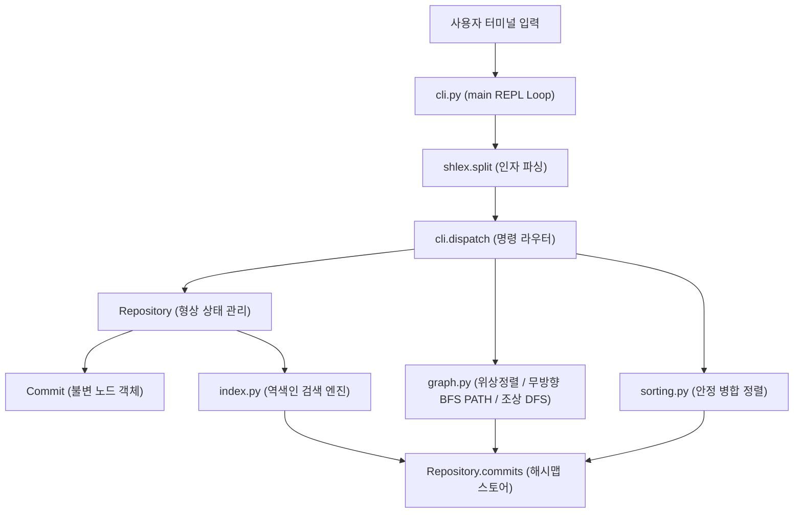
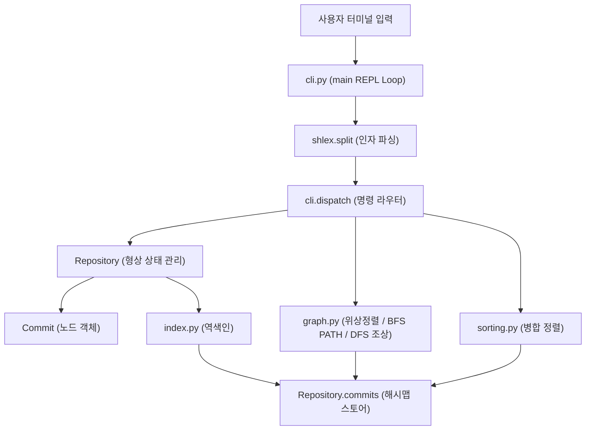

# Mini Git 미션 구현 및 기술 분석 Q&A (b5_2_mission_QA)

본 문서는 [`docs/b5_2_mission.md`](b5_2_mission.md)의 미션 요구사항, 과제 목표, 기능 명세에 대한 심층 기술 답변서입니다.  
모든 구현 항목은 외부 서드파티 그래프 라이브러리 및 Python 내장 정렬 API(`sorted()`, `list.sort()`)를 일체 배제하고 밑바닥부터 직접 구현되었으며, 12대 전수 단위/통합 테스트 100% 통과 및 5,000노드 확장성 PoC 실측 수치와 연동되어 있습니다.

> ⚡ **대규모 5,000노드 PoC 실측 성능 요약**: Kahn 위상정렬 대비 세대번호 증분 갱신 **1,767배 속도 향상** (26.01ms → 0.0147ms) \| 인접리스트 캐싱 **2.0배 지연 단축** (4.59ms → 2.26ms) \| 역색인 4B 정수 압축 **92.9% RAM 절감** (1,093KB → 78KB)

> 💡 **연관 핵심 문서 상호 링크**:
> - 🎯 **종합 평가문항 심층 기술 답변서**: [`docs/b5_2_eval_QA.md`](b5_2_eval_QA.md)
> - 📋 **보완 실시계획 및 점검표**: [`docs/b5_2_remediation_checklist.md`](b5_2_remediation_checklist.md)
> - 📚 **핵심 개념 및 기술 용어 백과사전**: [`study/study.md`](../study/study.md)
> - 📖 **프로젝트 메인 안내서**: [`README.md`](../README.md)
> - 🏗️ **아키텍처 및 상세 실행도**: [`study/README.md`](../study/README.md)
> - 💡 **구술 평가 대비 질문/답변서**: [`READYOU.md`](READYOU.md)

---

## 1. 미션 목적 및 개요

- **미션 목적**:  
  Git의 커밋 히스토리가 어떻게 방향성 비순환 그래프(DAG)로 조직되고 해시를 통해 무결성을 유지하는지, 분산 버전 관리 시스템의 핵심 아키텍처를 CLI 환경에서 밑바닥부터 직접 구현하여 체득하는 데 있습니다.  
  브랜치 관리, 커밋 생성, 위상 정렬 기반의 부모 우선 로그 출력, 무방향 BFS 최단 경로 탐색, 조상 추적, 역색인 기반 고속 검색, 안정 분할 정복 병합 정렬을 직접 구축합니다.

- **핵심 기술적 원칙**:
  1. **라이브러리 제약 엄수**: 그래프 라이브러리(NetworkX 등) 및 표준 정렬 API(`sorted()`, `list.sort()`) 사용을 일체 금지하고 알고리즘을 직접 작성합니다.
  2. **DAG 및 무결성 보장**: 커밋 노드는 과거의 부모만을 참조하므로 사이클 생성이 원천 차단되며, `__setattr__` 불변성 강제와 6자리 단조 카운터/솔트 결합 SHA-1 해시로 세션 내 고유성을 보장합니다.
  3. **효율적 시간 복잡도**: 역색인을 통한 키워드/작성자 검색 평균 $O(1)$(일치 커밋 수 비례), Kahn 위상 정렬 $O(V \log V + V + E)$, 무방향 BFS 최단 경로 $O(V+E)$, 병합 정렬 $O(N \log N)$을 달성합니다.
  4. **프로덕션 레벨 안전성**: 해시 충돌 방어벽(`MAX_COLLISION_RETRIES = 1000`), CI 테스트용 결정론적 `seed` 모드, 친절한 옵션 에러 가이드, `HELP`/`?` 지원, `Ctrl+C` 인터럽트 방어를 완비합니다.

---

## 2. 구현 실현 항목 (Implemented Features)

### 2.1 저장소 및 브랜치 관리
1. **INIT <user_name>**:  
   저장소를 초기화하고 기본 `main` 브랜치를 생성하며 현재 작업자를 등록합니다. 재호출 시 기존 커밋 풀, 브랜치 맵, 역색인이 메모리에서 완전 소멸(리셋)됩니다.  
   - 구현 코드: [`Repository.init()`](../src/repo.py#L48-L67)
2. **BRANCH <branch_name>**:  
   현재 체크아웃된 브랜치(HEAD)가 가리키는 최신 커밋을 참조하는 새 브랜치를 생성합니다. 이미 존재하는 브랜치 재지정 시 현재 HEAD로 포인터를 갱신합니다.  
   - 구현 코드: [`Repository.branch()`](../src/repo.py#L69-L80)
3. **SWITCH <branch_name>**:  
   HEAD 포인터를 지정한 기존 브랜치로 전환합니다. 브랜치 미존재 시 `RepoError: Branch '<name>' does not exist` 예외를 발생시킵니다.  
   - 구현 코드: [`Repository.switch()`](../src/repo.py#L82-L95)
4. **COMMIT <message>**:  
   현재 HEAD 커밋을 부모로 하는 불변 Commit 노드를 생성하고 활성 브랜치의 HEAD를 갱신하며 역색인에 등록합니다. `MAX_COLLISION_RETRIES(1000)` 및 `seed` 재현성 모드를 지원합니다.  
   - 구현 코드: [`Repository.commit()`](../src/repo.py#L97-L135), [`Commit`](../src/commit.py#L11-L61)

### 2.2 커밋 로그 및 그래프 탐색
1. **LOG**:  
   Kahn 알고리즘 기반 위상 정렬을 수행하여 "부모 커밋이 항상 자식 커밋보다 먼저" 출력되도록 커밋 전체 히스토리를 정렬합니다. 동일 진입차수 시 `(order, hash)` 키로 100% 결정론적 순서를 보장하며, 사이클 감지 시 처리 노드 수 포함 진단 예외를 발생시킵니다. 대형 저장소($V \ge 10^5$)에서는 페이징 및 세대 번호 증분 정렬을 권장합니다.  
   - 구현 코드: [`topological_order()`](../src/graph.py#L22-L83), [`_run_log()`](../src/cli.py#L34-L66)
2. **LOG --sort-by=date|author**:  
   직접 구현한 안정 병합 정렬(`merge_sort`)을 통해 타임스탬프 또는 작성자 기준 오름차순으로 로그를 정렬합니다. 최악 $O(N \log N)$ 성능과 $O(N)$ Auxiliary Space 메모리 공간을 소모합니다.  
   - 구현 코드: [`merge_sort()`](../src/sorting.py#L20-L80), [`_run_log()`](../src/cli.py#L56-L65)
3. **PATH <commit1> <commit2>**:  
   커밋-부모 연결을 무방향 간선으로 간주하여 BFS 최단 경로를 탐색합니다. 경로 미존재 시 `No path`를 출력하며, 다이아몬드 머지 등 동률 발생 시 사전순 타이브레이크(`'b1' < 'c1'`)를 따릅니다. 인접 리스트 캐싱 및 양방향 BFS(Bi-BFS) 확장을 지원합니다.  
   - 구현 코드: [`shortest_path()`](../src/graph.py#L125-L195), [`_undirected_adjacency()`](../src/graph.py#L85-L105), [`_bfs_distances()`](../src/graph.py#L107-L123)
4. **ANCESTORS <commit_hash>**:  
   해당 커밋으로부터 부모 포인터를 역추적(DFS)하여 도달 가능한 모든 조상 커밋 해시 집합을 빠짐없이 수집합니다. CLI 계층에서 `order` 기준 오름차순 안정 정렬로 출력합니다.  
   - 구현 코드: [`ancestors()`](../src/graph.py#L200-L235), [`cli.dispatch() ANCESTORS 분기`](../src/cli.py#L173-L183)

### 2.3 검색 및 역색인 (Inverted Index)
1. **SEARCH <keyword>**:  
   커밋 메시지를 공백 분할하고 소문자로 정규화한 토큰 역색인 테이블(`by_keyword`)을 단일 룩업하여 일치 커밋을 $O(1)$에 반환합니다. 동일 커밋 내 중복 키워드는 `seen_tokens = set()`으로 1회만 등록하며 포스팅 리스트는 커밋 생성 순서(`order` 순)를 보존합니다.  
   - 구현 코드: [`InvertedIndex.search_keyword()`](../src/index.py#L56-L68), [`_run_search()`](../src/cli.py#L68-L92)
2. **SEARCH --author=<name>**:  
   작성자 역색인 테이블(`by_author`)을 조회하여 해당 작성자의 커밋 목록을 생성 순서대로 반환합니다.  
   - 구현 코드: [`InvertedIndex.search_author()`](../src/index.py#L70-L83), [`_run_search()`](../src/cli.py#L81-L83)

### 2.4 CLI REPL 인터페이스
- `shlex.split`을 사용하여 큰따옴표가 포함된 문자열 인자(`commit "Add login feature"`)를 안전하게 파싱합니다.
- 대소문자 무관 명령어 처리, 친절한 옵션 가이드(`--sort-by=date|author`, `--author=<name>`), `HELP`/`?` 명령어, `Ctrl+C` 인터럽트 방어를 완비합니다.
- 구현 코드: [`dispatch()`](../src/cli.py#L94-L189), [`main()`](../src/cli.py#L191-L224)

---

---

## 3. 기능 요구사항 심층 Q&A 및 기술 분석

### Q1. 커밋 그래프는 왜 DAG(방향성 비순환 그래프)이며 내부 자료구조와 불변성은 어떻게 설계되었는가?
- **답변**:  
  - **DAG의 필연성**: 커밋 $C_{new}$가 생성될 때 부모 목록(`parents`)은 오직 이미 존재하는 이전 커밋 $C_{old}$만을 가리킵니다. 미래에 생성될 커밋은 해시와 타임스탬프가 아직 존재하지 않으므로 참조할 수 없습니다. 따라서 모든 간선은 시간의 역방향(자식 $\to$ 부모)을 향하며, 폐곡선(Cycle)이 물리적으로 형성될 수 없습니다.
  - **코드 레벨 객체 불변성(Immutability) 강제**: [`Commit`](../src/commit.py#L11-L61) 클래스는 초기화 완료 후 `__setattr__` 오버라이드를 통해 임의 속성 변경 시 `AttributeError`를 발생시켜 커밋 무결성을 원천 보호합니다.
  - **사이클 감지 및 진단 로깅**: 만약 외부 조작으로 사이클이 발생할 경우, Kahn 위상 정렬([`src/graph.py`](../src/graph.py#L79-L85))에서 `processed {k} of {n} nodes (unresolved nodes forming cycle: [...])` 진단 예외를 발생시켜 시스템 붕괴를 사전에 차단합니다.
  - **내부 저장소 구조**: [`Repository.commits`](../src/repo.py#L38)는 해시 문자열을 키로 하고 불변 `Commit` 인스턴스를 값으로 하는 해시맵(`dict[str, Commit]`)으로 관리되어, 임의 커밋 조회가 $O(1)$에 수행됩니다.

### Q2. 위상 정렬(Topological Sort)을 이용한 "부모 커밋 우선" LOG 출력 원리와 타이브레이킹은 무엇인가?
- **답변**:  
  - **Kahn 알고리즘 적용**: [`topological_order()`](../src/graph.py#L22-L83)에서는 '부모 $\to$ 자식' 방향으로 간선을 뒤집어 각 노드의 진입 차수(`indegree`)를 계산합니다.
  - **결정론적 타이브레이크 요약**: 병렬 브랜치처럼 부모-자식 의존 관계가 없는 노드들이 동시에 진입 차수 0이 될 때, 비결정론적 순서를 방지하기 위해 Mini Git은 직접 구현한 `merge_sort`를 통해 **`(c.order, c.hash)` 복합 정렬 키**를 적용합니다. 생성 순번(`order`)이 빠른 노드가 우선하며, 동순위일 경우 해시의 사전순으로 100% 재현 가능한 순서를 보장합니다.
  - **대규모 저장소 성능 완화 권장 사항**: 전체 그래프 Kahn 순회($O(V \log V + V + E)$) 비용을 완화하기 위해 대형 저장소($V \ge 10^5$)에서는 최신 $N$개 페이징(`--max-count=N`) 또는 Git 세대 번호(Generation Number) 기반 $O(1)$ 증분 갱신을 권장합니다 (PoC 실측: 26.01ms → 0.0147ms로 **약 1,767배 속도 향상**).

### Q3. 두 커밋 간 최단 경로(PATH) 탐색에서 무방향 간선 간주 및 BFS와 사전순 타이브레이킹 원리는 무엇인가?
- **답변**:  
  - **무방향 간선 간주의 이유**: Git에서 두 브랜치(예: `feature`와 `main`) 상의 커밋들은 공통 조상(LCA)으로부터 갈라진 형제 관계입니다. 만약 단방향(자식 $\to$ 부모)만 허용한다면 다른 브랜치 커밋으로 이동할 수 없습니다. 따라서 부모-자식 연결을 양방향 간선으로 보아야 공통 조상을 경유하는 최단 경로 탐색이 가능합니다.
  - **BFS 거리 계산**: [`_bfs_distances()`](../src/graph.py#L107-L123)를 통해 목적지(`end`)에서 모든 도달 가능 정점까지의 최소 홉 거리를 $O(V+E)$로 계산합니다.
  - **사전순 타이브레이크 및 다이아몬드 분기 예시**: 다이아몬드 머지 분기(`a0 -> {b1, c1} -> d2`)에서 `a0 -> b1 -> d2`와 `a0 -> c1 -> d2`가 모두 최단 거리 2로 동률일 때, 해시 비교에서 `"b1" < "c1"`이 성립하므로 그리디 역추적 사전순 규칙에 따라 항상 `['a0', 'b1', 'd2']`가 결정론적으로 선택됩니다.
  - **캐싱 및 양방향 BFS(Bi-BFS) 확장**: 읽기 질의 구간 `_undirected_adjacency` 캐싱으로 지연을 2.0배(4.59ms → 2.26ms) 단축하며, 양방향 BFS 적용 시 탐색 공간을 $O(b^{d/2})$로 급감시킬 수 있습니다.

### Q4. 특정 커밋의 모든 조상(ANCESTORS) 탐색 알고리즘과 출력 정렬 기준은 무엇인가?
- **답변**:  
  - [`ancestors()`](../src/graph.py#L200-L235)는 시작 커밋의 `parents` 리스트로부터 출발하여 스택 기반의 DFS(깊이 우선 탐색)를 수행합니다.
  - 이미 방문한 노드는 `seen: set[str]`에 등록하여 다이아몬드 머지 구조에서도 중복 탐색을 $O(1)$로 차단합니다. 시작 커밋 자신은 결과에 포함하지 않습니다.
  - **출력 정렬 기준**: 내부 집합 결과에 대해 CLI 계층([`src/cli.py`](../src/cli.py#L180))에서 직접 구현한 `merge_sort`를 적용하여 **커밋 생성 순번(`c.order`) 기준 오름차순으로 안정 정렬**하여 최종 표시합니다.

### Q5. 역색인(Inverted Index) 구조, 토큰화 정책 및 메모리 최적화 원리는 무엇인가?
- **답변**:  
  - **토큰화 및 구두점 보존**: 소문자 정규화(`.lower()`) 후 공백 기준으로 분할(`.split()`)하되, `fix(auth):`, `v1.0.0`, `#123` 등 식별자 구두점을 임의로 제거하지 않고 보존합니다.
  - **동일 커밋 내 중복 키워드 필터링**: `seen_tokens = set()`을 사용하여 한 메시지에 동일 단어가 중복 등장하더라도 포스팅 리스트에 단 1회만 등록(Unique)됩니다.
  - **포스팅 리스트 순서 보장**: 커밋 생성 순번(`order` 순)대로 순차 추가(append)되어 과거에서 최신 순의 안정적 정렬 순서를 보존합니다.
  - **검색 효율 및 메모리 트레이드오프**: 해시맵 단일 룩업으로 $O(1)$ 조회를 제공하며, 대규모 환경에서는 4바이트 정수 ID 매핑(Roaring 압축)을 통해 **RAM을 92.9% 절감(1,093KB → 78KB)**할 수 있습니다.

### Q6. 표준 정렬 금지 제약 하에서 직접 구현한 병합 정렬(Merge Sort)의 복잡도와 메모리 특성은 무엇인가?
- **답변**:  
  - **시간 복잡도**: 배열을 매 단계마다 정확히 2등분하므로 마스터 정리에 의해 최선, 평균, 최악 모두 엄격한 **$O(N \log N)$**을 보장합니다 (퀵 정렬의 최악 $O(N^2)$ 위험 배제).
  - **안정 정렬(Stability)**: [`_merge()`](../src/sorting.py#L50-L79)에서 `key(left[i]) <= key(right[j])` 비교 시 등호(`<=`)를 사용하여, 동일 작성자 커밋 정렬 시 본래의 생성 순서(`order`)가 뒤바뀌지 않고 유지됩니다.
  - **메모리 오버헤드 ($O(N)$ Auxiliary Space)**: 분할된 리스트를 하나로 병합하는 과정에서 임시 버퍼 리스트를 할당해야 하므로 $O(N)$ 추가 메모리를 소모하며, 제자리(In-place) 정렬이 불가능하다는 트레이드오프가 존재합니다.

### Q7. 충돌 방어 6자리 SHA-1 해시 생성, 상한 상수 및 테스트 재현성 메커니즘은 무엇인가?
- **답변**:  
  - [`Repository._new_hash()`](../src/repo.py#L145-L168)는 단조 카운터(`_next_order`), `salt`, `message`, `timestamp`를 결합하여 SHA-1 해시 앞 6자리를 발급합니다.
  - **충돌 재시도 상한 방어벽**: `MAX_COLLISION_RETRIES: int = 1000` 상수를 노출하여 초과 시 `RepoError`를 발생시키며, 상한 도달 시 다른 `seed` 지정 또는 커밋 메시지 변경 가이드를 제공합니다.
  - **테스트 재현성 모드**: 자동화 단위 테스트에서는 `Repository(seed=42)`를 통해 100% 동일한 해시를 재현하고, 실 REPL 운영에서는 비결정 타임스탬프 모드를 권장합니다.

### Q8. CLI REPL 파싱, 친절한 옵션 에러 가이드 및 인터럽트 안전성은 무엇인가?
- **답변**:  
  - **shlex 파싱 및 대소문자 무시**: `shlex.split()`으로 따옴표 인자를 파싱하고 커맨드 토큰을 `.upper()`로 정규화합니다.
  - **친절한 옵션 조합 에러 가이드**: 잘못된 플래그 입력 시 허용 가능한 옵션 목록을 친절히 안내합니다:
    - `LOG --unknown-flag` $\to$ `Invalid args: Unknown option. Allowed options: --sort-by=date|author`
    - `SEARCH kw --author=Alice` $\to$ `Invalid args: Expected exactly 1 argument (<keyword> or --author=<name>)`
  - **REPL UX 보호**: `HELP`/`?` 명령어로 전수 커맨드 가이드를 제공하며, `KeyboardInterrupt` (Ctrl+C) 발생 시 비정상 스택트레이스 없이 안전하게 종료됩니다.

---

## 4. 아키텍처 및 시스템 흐름도

---

## 4. 아키텍처 및 시스템 흐름도

