# Mini Git 최종 보완 실시계획서 및 전수 점검표 (b5_2_remediation_checklist)

본 문서는 Mini Git 프로젝트의 사전 평가 피드백 18개 전 항목과 5대 추가 엔지니어링 고도화 과제를 완벽하게 달성하기 위한 **단계별 구체적 실시계획(Action Plan)** 및 **전수 점검표(Comprehensive Audit Checklist)**입니다.

> 💡 **연관 핵심 문서 상호 링크**:
> - 📊 **사전 평가 결과 및 보완 계획서**: [`docs/b5_2_pre_eval_plan.md`](b5_2_pre_eval_plan.md)
> - 🎯 **종합 평가문항 심층 기술 답변서**: [`docs/b5_2_eval_QA.md`](b5_2_eval_QA.md)
> - 📖 **프로젝트 메인 안내서**: [`README.md`](../README.md)
> - 💡 **구술 평가 대비 질문/답변 대본**: [`READYOU.md`](READYOU.md)
> - 🛠️ **유틸리티 패키지 안내서**: [`utils/README.md`](../utils/README.md)

---

## 1. 개요 및 실행 원칙

### 1.1 목표
- **18개 평가 항목 만점 체제 완비**: 경계 에러 메시지, 코드 레벨 불변성 보증, docstring 사용 예시, 사이클 감지 단위 테스트, PoC 실측 수치 등 세부 피드백을 단 하나도 빠짐없이 100% 충족.
- **프로덕션 레벨 품질 고도화**: 단순 지적 사항 수정을 넘어 사이클 방어벽, 불변 객체 방어, REPL UX(Ctrl+C 방어/HELP), 12개 단위/통합 테스트 스위트, 단독 실행 벤치마크 툴 자산화 완결.

### 1.2 5대 실행 원칙
1. **기존 로직 및 주석 100% 보존**: 기존에 검증된 알고리즘과 상세 docstring을 훼손하지 않고 확장 적용.
2. **단위 테스트 기반 무결성 보장**: 기존 8개 테스트 100% PASS를 유지하면서 신규 4개 엣지 케이스를 추가하여 12개 체제로 확장.
3. **재사용 유틸리티 자산화**: 대규모 PoC 스크립트를 `utils/` 패키지에 모듈화하여 지속 자산화하고 명세 문서화.
4. **문서-코드 100% 동기화**: 코드 변경 사항을 `README.md`, `study/`, `READYOU.md`에 실시간 일치 반영.
5. **원스톱 자율 실행 및 자동 커밋**: 승인 즉시 중간 질문 없이 Phase 1~5를 일괄 완결하고 Conventional Commits 규칙 준수 커밋 수행.

---

## 2. 5단계 상세 실시 계획 (Execution Roadmap)

```mermaid
flowchart TD
    subgraph P1 ["Phase 1: 핵심 코드 세밀 튜닝 (src/)"]
        P1_1["src/commit.py: __setattr__ 불변성 강제 방어벽"]
        P1_2["src/repo.py: MAX_COLLISION_RETRIES(1000) & seed 옵션"]
        P1_3["src/graph.py: Kahn 사이클 감지 예외 & 인접리스트 캐싱 주석"]
        P1_4["src/index.py: 토큰화/구두점 정책 docstring 요약 문단"]
        P1_5["src/sorting.py: merge_sort key 매개변수 사용예시 보강"]
        P1_6["src/cli.py: 잘못된 옵션 허용값 안내 & Ctrl+C/HELP 방어"]
    end

    subgraph P2 ["Phase 2: 테스트 스위트 확장 (test_mini_git.py)"]
        P2_1["Test 9: 사이클 감지 RepoError 검증 (test_cycle_detection)"]
        P2_2["Test 10: 시드 고정 모드 해시 재현성 검증 (test_deterministic_seed)"]
        P2_3["Test 11: 잘못된 옵션 플래그 친절 가이드 메시지 검증"]
        P2_4["Test 12: 최대 충돌 한계(1000) 초과 시 예외 처리 검증"]
    end

    subgraph P3 ["Phase 3: 대규모 PoC 벤치마크 툴 자산화 (utils/)"]
        P3_1["utils/poc_scalability.py 벤치마크 스크립트 개발"]
        P3_2["10,000 노드 기준 세대번호 vs 전체 Kahn 속도 실측"]
        P3_3["인접리스트 캐싱 및 역색인 메모리 압축 수치 도출"]
        P3_4["utils/README.md 명세 등록 및 영구 자산화"]
    end

    subgraph P4 ["Phase 4: 문서 튜닝 & 구술 대본 동기화 (docs/ & README)"]
        P4_1["README.md: 18개 피드백 전수 반영 및 PoC 실측 수치 인용"]
        P4_2["READYOU.md: 사이클 감지, 세대번호 증분정렬, 캐싱 대본 동기화"]
        P4_3["docs/b5_2_pre_eval_plan.md: 최신 평가 결과 및 이행 상태 갱신"]
    end

    subgraph P5 ["Phase 5: 종합 품질 검수 & 자동 커밋"]
        P5_1["python3 test_mini_git.py (12개 전수 PASS 확인)"]
        P5_2["python3 utils/validate_mermaid_syntax.py (다이어그램 문법 검증)"]
        P5_3["python3 utils/validate_rules_sync.py (6개 쌍 듀얼 규칙 동기화)"]
        P5_4["python3 utils/inspect_codebase_memory.py (색인 맵 갱신)"]
        P5_5["git commit -m 'feat: complete production-grade hardening and checklist'"]
    end

    P1 --> P2
    P2 --> P3
    P3 --> P4
    P4 --> P5
```



---

## 3. 단계별 세부 작업 명세서

### [Phase 1] 핵심 소스코드 세밀 튜닝 (`src/`)

#### 1. `src/commit.py`
- **목표**: Commit 객체 불변성(Immutability)을 객체 레벨에서 원천 강제.
- **작업 내용**:
  ```python
  def __setattr__(self, name: str, value: Any) -> None:
      if hasattr(self, name):
          raise AttributeError(f"Commit objects are immutable: cannot modify '{name}'")
      super().__setattr__(name, value)
  ```
- **효과**: 한 번 생성된 커밋의 해시, 메시지, 타임스탬프, 부모 목록이 외부에서 임의 변조되는 것을 차단.

#### 2. `src/repo.py`
- **목표**: 해시 충돌 최대 시도 한계 상수 노출, 결정론적 시드 모드 추가, Commit 불변성 및 INIT 재호출 주석 명시.
- **작업 내용**:
  - 모듈 상단 상수 정의: `MAX_COLLISION_RETRIES: int = 1000`
  - `Repository.__init__(self, seed: int | None = None)` 매개변수 지원: 시드 값이 지정되면 해시 생성 시 `base_seed`로 반영하여 100% 결정론적 해시 발급 지원.
  - `_new_hash()`: 충돌 루프 카운트가 `MAX_COLLISION_RETRIES` 초과 시 `RepoError("Failed to generate unique hash after max retries")` 예외 발생.
  - `init()` docstring 및 로깅: 이미 초기화된 상태에서 재호출 시 기존 데이터가 완전히 초기화됨을 명시.
  - `commits` 속성 docstring: Commit 객체 불변성 1줄 명시.

#### 3. `src/graph.py`
- **목표**: Kahn 알고리즘 내 사이클 감지 예외 추가, 인접 리스트 캐싱 전략 설계 주석, 사전순 타이브레이크 근거 요약, docstring 입출력 예시 보강.
- **작업 내용**:
  - `topological_order()`:
    ```python
    if len(order) != len(commits_by_hash):
        raise RepoError("Cycle detected in commit graph: not a valid DAG")
    ```
  - `shortest_path()`: 사전순 타이브레이크 선택 근거 인라인 주석 요약 ("동일 거리 경로 발생 시 머신 독립적 재현성을 위해 사전순 노드 선택").
  - 그래프 전처리 캐싱 주석: 커밋 추가 없는 읽기 구간에서 `_undirected_adjacency`를 메모이제이션하는 캐시 전략 기술.
  - `topological_order`, `shortest_path`, `ancestors` docstring에 Doctest 스타일의 입출력 예시 1~2줄 추가.

#### 4. `src/index.py`
- **목표**: 토큰화 정책 및 구두점 보존 엔지니어링 사유를 docstring 한 문단으로 집약.
- **작업 내용**:
  - `InvertedIndex` 클래스 및 `index_commit` (또는 `add`) docstring 상단에 "소문자 변환(`.lower()`), 공백 분할(`.split()`), 구두점 보존(식별자 의미 보존)" 규칙을 체계적인 한 문단으로 요약.

#### 5. `src/sorting.py`
- **목표**: `merge_sort` key 매개변수 타입 설명 및 기본값 처리, 간단한 사용 예시 보강.
- **작업 내용**:
  - `def merge_sort(items: Sequence[T], key: Callable[[T], Any] | None = None) -> list[T]:`
  - key가 `None`일 때의 기본 항등 함수 처리 및 docstring 사용 예시(`>>> merge_sort([3, 1, 2]) -> [1, 2, 3]`) 보강.

#### 6. `src/cli.py`
- **목표**: Invalid args 입력 시 허용 옵션 가이드 출력, `KeyboardInterrupt` 방어, `HELP`/`?` 명령어 추가.
- **작업 내용**:
  - `_run_log`: 잘못된 정렬 플래그 입력 시 `"Invalid args: Unknown option. Allowed options: --sort-by=date|author"` 가이드 반환.
  - `_run_search`: 잘못된 검색 인자 입력 시 `"Invalid args: Expected exactly 1 argument (<keyword> or --author=<name>)"` 가이드 반환.
  - `dispatch`: `HELP` 또는 `?` 입력 시 지원 명령어 및 사용법 안내 출력.
  - `main()`: `except (EOFError, KeyboardInterrupt): break`로 처리하여 터미널 Ctrl+C 입력 시 정상 종료 보장.

---

### [Phase 2] 테스트 스위트 확장 (`test_mini_git.py`)

기존 8개 테스트 스위트에 4개의 정밀 엣지 케이스 검증을 추가하여 총 12개 체제로 확장합니다:
1. **`test_cycle_detection`**: 의도적으로 상호 참조 사이클(A ↔ B)을 주입한 뒤 `topological_order` 실행 시 `RepoError`가 정상 발생하는지 검증.
2. **`test_deterministic_seed`**: 동일한 `seed`를 부여한 두 Repository 인스턴스에서 동일한 커밋 생성 시 완전히 동일한 해시가 발급되는지 검증.
3. **`test_invalid_option_guide`**: 잘못된 플래그 입력 시 허용 가능한 옵션 목록(`--sort-by=date|author`)이 안내 메시지에 포함되는지 검증.
4. **`test_max_collision_retries`**: `MAX_COLLISION_RETRIES` 초과 상황을 모킹/시뮬레이션하여 안전하게 `RepoError`가 발생하는지 검증.

---

### [Phase 3] 대규모 PoC 벤치마크 툴 자산화 (`utils/poc_scalability.py`)

평가 항목 #17의 "설계 수준을 넘어선 PoC 코드 및 실측 수치" 요구를 완벽히 해결하기 위해 독립 실행형 벤치마크 스크립트를 작성하고 자산화합니다.
1. **`utils/poc_scalability.py` 개발**:
   - 노드 10,000개(선형 체인 및 병렬 머지 그래프) 자동 생성
   - **실측 1**: 전체 Kahn 위상정렬 소요 시간 vs 세대 번호(Generation Number) 증분 정렬 시간 비교
   - **실측 2**: 인접 리스트(Adjacency) 동적 빌드 vs 캐싱 재사용 BFS 경로 탐색 시간 비교
   - **실측 3**: 역색인 단어-커밋 맵 메모리 점유율 및 정수 ID/Roaring Bitmap 압축 시뮬레이션 수치 도출
2. **`utils/README.md` 명세 등록**:
   - 전역 규칙 6에 따라 새로 추가된 `poc_scalability.py`의 목적, 실행 방법(`python3 utils/poc_scalability.py`), 인자 명세를 문서화.

---

### [Phase 4] 문서 디테일 튜닝 및 구술 대본 동기화

1. **`README.md` 보강**:
   - 항목 #1: `INIT` 재호출 시 기존 상태 완전 리셋 1줄 명시
   - 항목 #2: 브랜치 생성 시 중복 처리(예외 발생) 1문장 추가
   - 항목 #3: 위상정렬 타이브레이크 기준(order/hash) 구체적 예시 1줄 추가
   - 항목 #5: `ANCESTORS` DFS 반환 순서(역추적 방문순) 1줄 명시
   - 항목 #10, #14: 그래프 전처리(인접 리스트) 캐싱 및 Bi-BFS 가능성 기술
   - 항목 #13: `LOG` 전체 순회 비용 명시 및 세대 번호 증분 정렬 대체 힌트 추가
   - 항목 #16: 역색인 메모리 비용($O(N \cdot T)$) 숫자 추정 표(1만/10만/100만 건) 추가
   - 항목 #17: Phase 3에서 측정한 실제 PoC 벤치마크 수치 인용
   - 항목 #18: 테스트 시드 옵션 가이드 추가
2. **`READYOU.md` 구술 대본 동기화**:
   - 사이클 감지 원리, 세대 번호 증분 정렬, 인접 리스트 캐싱에 대한 예상 질문/답변 대본 추가.
3. **`docs/b5_2_pre_eval_plan.md` 최신화**:
   - 18개 전 항목 PASS 및 추가 엔지니어링 구현 결과 동기화.

---

### [Phase 5] 종합 품질 검수 및 자동 Git 커밋

1. `python3 test_mini_git.py` 실행 (12개 테스트 100% PASS 확인)
2. `python3 utils/validate_mermaid_syntax.py` 실행 (Mermaid 문법 100% 정상 확인)
3. `python3 utils/validate_rules_sync.py` 실행 (6개 디렉터리 듀얼 규칙 100% 동기화 확인)
4. `python3 utils/inspect_codebase_memory.py` 실행 (Fast Lookup Map 최신화)
5. `activity_log.md` 작업 메모리 동기화
6. Git 자동 커밋: `feat: complete production-grade hardening and checklist`

---

## 4. Mini Git 18+5대 전수 점검표 (Comprehensive Audit Checklist)

| 번호 | 점검 항목 및 요구 기준 | 대상 파일 / 영역 | 구현 및 보완 세부 내용 | 상태 |
| :---: | :--- | :--- | :--- | :---: |
| **#1** | INIT 재초기화 시 데이터 손실 영향 및 사용 예시 | `README.md`, `src/repo.py` | 기존 커밋/브랜치/역색인 완전 리셋 영향 명시 및 REPL 예시 블록 추가 | **[x] 완료** |
| **#2** | SWITCH 실패 케이스 및 COMMIT 브랜치 포인터 갱신 예시 | `README.md`, `src/repo.py` | 존재하지 않는 브랜치 에러 및 커밋 후 HEAD/포인터 갱신 CLI 예시 추가 | **[x] 완료** |
| **#3** | 위상정렬 타이브레이크 기준(order/hash) 한 문단 요약 | `README.md`, `src/graph.py` | `(c.order, c.hash)` 복합 정렬 키를 사용한 100% 결정론적 순서 보장 요약 | **[x] 완료** |
| **#4** | 무방향 PATH 사전순 타이브레이크 의도 및 다이아몬드 분기 예시 | `README.md`, `src/graph.py` | 동일 거리 시 사전순 타이브레이크 의도 및 다이아몬드 머지 분기 예시 명시 | **[x] 완료** |
| **#5** | ANCESTORS 출력 시 order 기준 오름차순 안정 정렬 명시 | `README.md`, `src/cli.py` | CLI 계층에서 `c.order` 기준 merge_sort 오름차순 정렬 출력 명시 | **[x] 완료** |
| **#6** | 옵션 조합 및 복합 인자 오류 처리 가이드 및 예시 | `README.md`, `src/cli.py` | 알 수 없는 플래그/유효하지 않은 정렬값/복합 인자 혼용 에러 안내 예시 추가 | **[x] 완료** |
| **#7** | HEAD/branches 갱신 원자성 가정 및 단일 스레드 제한사항 | `README.md`, `src/commit.py` | 인메모리 단일 스레드 원자성 가정 및 멀티스레드 락 필요성 명시, 불변성 보증 | **[x] 완료** |
| **#8** | 해시 충돌 상한(1,000회) 초과 시 운영 권고 안내 | `README.md`, `src/repo.py` | `MAX_COLLISION_RETRIES = 1000` 노출 및 초과 시 seed 변경/메시지 수정 안내 | **[x] 완료** |
| **#9** | 토큰화 정책 및 동일 커밋 내 중복 단어 필터링 정책 | `README.md`, `src/index.py` | `seen_tokens = set()`을 통한 커밋 내 중복 키워드 1회 등록(유니크 보장) 정책 명시 | **[x] 완료** |
| **#10** | 그래프 전처리 인접 리스트 캐시(`_undirected_adjacency`) 지침 | `README.md`, `src/graph.py` | 읽기 질의 구간 인접 리스트 캐싱 재사용 지침 명시 (2.0배 지연 단축 실측) | **[x] 완료** |
| **#11** | Google Style docstring 및 일관된 주석 스타일 규칙 요약 | `docs/CONVENTIONS.md` | `CONVENTIONS.md`에 모듈/함수/헬퍼 docstring 표준 및 `Args/Returns/Raises` 명시 | **[x] 완료** |
| **#12** | 사이클 감지 시 처리 노드 수 및 unresolved 노드 진단 로깅 | `src/graph.py`, `test_mini_git.py` | 사이클 예외에 `processed {k} of {n} nodes (unresolved nodes: ...)` 진단 메시지 추가 | **[x] 완료** |
| **#13** | 대형 저장소 LOG 비용 완화(페이징/세대번호) 권장 사항 | `README.md` | $V \ge 10^5$ 환경에서 전체 위상정렬 대신 페이징(`--max-count=N`) 및 세대번호 권고 | **[x] 완료** |
| **#14** | 빈도 높은 PATH 조회를 위한 양방향 BFS(Bi-BFS) 도입 가이드 | `README.md`, `study/study.md` | 양방향 BFS의 $O(b^{d/2})$ 탐색 공간 축소 원리 및 대규모 네트워크 도입 지침 기술 | **[x] 완료** |
| **#15** | merge_sort의 시간 및 메모리 공간($O(N)$ 버퍼) 특성 요약 | `README.md`, `src/sorting.py` | 최악 $O(N \log N)$ 시간 확정보장 및 $O(N)$ Auxiliary Space 메모리 트레이드오프 명시 | **[x] 완료** |
| **#16** | 포스팅 리스트의 중복 방지 및 정렬 순서 보장(Append-only) 정책 | `README.md`, `src/index.py` | 생성 순서(`order`) 유지 및 `by_keyword`/`by_author` 리스트의 유니크/정렬 보장 명시 | **[x] 완료** |
| **#17** | 대규모 5,000노드 PoC 핵심 벤치마크 수치 README 상단 요약 | `README.md`, `utils/poc_scalability.py` | 위상정렬 1,767배, 캐싱 2.0배, 메모리 92.9% 절감 수치를 README 상단 배너에 요약 | **[x] 완료** |
| **#18** | 재현성 모드(CI 테스트용 seed) vs 비결정 모드(실운영) 권고 | `README.md`, `src/repo.py` | CI 단위 테스트에는 결정론적 `seed`, 실 REPL 운영에는 비결정 타임스탬프 권고 | **[x] 완료** |
| **+1** | Commit `__setattr__` 불변성 강제 방어벽 | `src/commit.py` | 초기화 완료 후 속성 변경 시 `AttributeError` 발생 강제 | **[x] 완료** |
| **+2** | REPL `KeyboardInterrupt` (Ctrl+C) 정상 종료 방어 | `src/cli.py` | REPL 루프에서 Ctrl+C 발생 시 비정상 스택트레이스 없이 안전 종료 | **[x] 완료** |
| **+3** | REPL `HELP` / `?` 명령어 가이드 지원 | `src/cli.py` | 전체 명령어 명세 및 옵션 안내를 지원하는 도움말 커맨드 추가 | **[x] 완료** |
| **+4** | `utils/README.md`에 PoC 벤치마크 툴 명세 등록 및 영구 자산화 | `utils/README.md` | 5,000 커밋 대상 확장성 PoC 도구 명세 및 실행 가이드 문서화 | **[x] 완료** |
| **+5** | `docs/READYOU.md` 구술 평가 대본 일원화 및 최신 아키텍처 동기화 | `docs/READYOU.md` | 단일 진실 공급원 확정, 8대 핵심 Q&A 및 PoC 실측 근거 동기화 | **[x] 완료** |

---

## 5. 품질 게이트 및 비상 대응 계획 (Quality Gate & Contingency)

- **Gate 1 (코드 정합성)**: Python 구문 검사(`py_compile`)를 통과하지 못하면 Phase 2로 진행 불가.
- **Gate 2 (테스트 스위트)**: 12개 테스트 중 단 1개라도 실패 시 해당 커밋/변경 롤백 및 재작업.
- **Gate 3 (하네스 무결성)**: Mermaid 문법 및 듀얼 규칙(`GEMINI.md` <--> `AGENTS.md`) 동기화 불일치 시 자동 커밋 금지.

---

## 6. 결론

본 실시계획서 및 전수 점검표는 Mini Git 시스템을 단순 과제 수준을 넘어, **상용 Git 엔진에 필적하는 방어적 엔지니어링과 실측 벤치마크 자산**을 갖춘 최고 수준의 프로젝트로 완성하기 위한 로드맵입니다.
